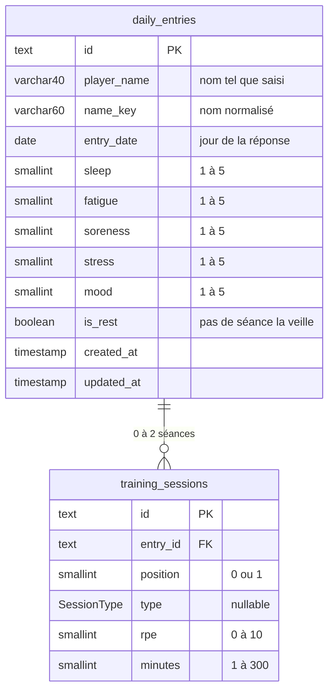

# Charge & Récup

Suivi de la charge d'entraînement et de la récupération d'une équipe.

- **Joueurs** : un lien unique, le même chaque matin. Ils écrivent leur nom et répondent en 1 à 2 minutes
  (5 notes de bien-être + les séances de la veille, jusqu'à 2 par jour).
- **Staff** : un tableau protégé par mot de passe, avec les calculs automatiques par joueur
  (bien-être, charge aiguë, charge chronique, RCAC, indice de fraîcheur, monotonie, contrainte),
  l'historique par joueur, la navigation jour par jour et le graphique de charge de l'équipe.
- Interface en **français et en anglais** (boutons FR / EN).

**Stack** : Next.js 14 (App Router) · React 18 · TypeScript · Prisma 5 · PostgreSQL.

---

## Démarrage

Prérequis : Node.js 18.18 ou plus récent, et une base PostgreSQL (Docker fourni).

```bash
npm install

cp .env.example .env          # puis renseigner STAFF_PASSWORD et SESSION_SECRET
docker compose up -d          # PostgreSQL local (ou utiliser sa propre base)

npx prisma db push            # crée les tables à partir de prisma/schema.prisma
npm run dev                   # http://localhost:3000
```

- Page des joueurs : `http://localhost:3000/`
- Espace staff : `http://localhost:3000/staff` (mot de passe = `STAFF_PASSWORD`)

Autre façon de créer la base, avec des contraintes CHECK en plus (notes de 1 à 5, intensité de 0 à 10…) :

```bash
psql "$DATABASE_URL" -f db/schema.sql
npx prisma generate
```

### Variables d'environnement

| Variable | Obligatoire | Rôle |
|---|---|---|
| `DATABASE_URL` | oui | Connexion PostgreSQL. |
| `STAFF_PASSWORD` | oui | Mot de passe de l'espace staff. |
| `SESSION_SECRET` | oui | Secret (16 caractères minimum) qui signe le cookie staff. `openssl rand -base64 32` |
| `APP_TIMEZONE` | non | Fuseau de l'équipe, `Africa/Tunis` par défaut. Il décide du jour d'une réponse. |
| `PLAYER_KEY` | non | Si défini, le lien des joueurs devient `https://site/?k=<PLAYER_KEY>`. Sans la clé, la page et l'API refusent. |

### Déploiement

Le plus simple : Vercel pour l'application + une base PostgreSQL hébergée (Neon, Supabase, Railway…).
Renseigner les mêmes variables d'environnement, puis lancer `npx prisma db push` une fois contre la base de production.
Le script `build` exécute déjà `prisma generate`.

---

## Schéma de la base de données

Deux tables. Il n'y a volontairement **pas de table « joueurs »** : les joueurs écrivent leur nom, et les
variantes d'écriture sont regroupées à la lecture (voir « Regroupement des noms »). Les données saisies ne sont
donc jamais modifiées.



### `daily_entries` : une réponse du matin

| Colonne | Type | Description |
|---|---|---|
| `id` | text, clé primaire | Identifiant (cuid). |
| `player_name` | varchar(40) | Nom tel que le joueur l'a écrit. |
| `name_key` | varchar(60) | Nom normalisé : minuscules, sans accents, mots séparés par des tirets. |
| `entry_date` | date | Jour de la réponse, dans le fuseau `APP_TIMEZONE`, calculé par le serveur. |
| `sleep`, `fatigue`, `soreness`, `stress`, `mood` | smallint | Notes de 1 (très mauvais) à 5 (excellent). Le bien-être du jour est leur somme, de 5 à 25. |
| `is_rest` | boolean | Vrai si le joueur n'a pas fait de séance la veille. |
| `created_at`, `updated_at` | timestamp | Dates de création et de dernière modification. |

Contrainte d'unicité : `(name_key, entry_date)`. Renvoyer le questionnaire le même jour avec le même nom
**remplace** la réponse précédente (mise à jour, pas de doublon).

### `training_sessions` : les séances de la veille

| Colonne | Type | Description |
|---|---|---|
| `id` | text, clé primaire | Identifiant (cuid). |
| `entry_id` | text, clé étrangère | Vers `daily_entries.id`, suppression en cascade. |
| `position` | smallint | `0` = première séance, `1` = deuxième séance du jour. |
| `type` | enum `SessionType`, nullable | `MUSCU`, `TRAINING`, `COMBO` (musculation + entraînement), `MATCH`, `OTHER`. |
| `rpe` | smallint | Intensité ressentie, de 0 (repos) à 10 (maximal). |
| `minutes` | smallint | Durée, de 1 à 300. |

Contrainte d'unicité : `(entry_id, position)`.

### Règles à connaître

- **Une réponse datée D décrit les séances de la veille (D − 1)**, mais le bien-être du matin de D.
  La charge du jour J se lit donc dans la réponse du jour J + 1.
- **Charge d'une journée** = somme de `rpe × minutes` sur ses séances. Repos = 0.
- Aucune suppression automatique. Seul le bouton « Supprimer » du staff retire des données.

Exemple de requête SQL, charge par joueur et par jour :

```sql
SELECT e.player_name, e.entry_date,
       CASE WHEN e.is_rest THEN 0 ELSE COALESCE(SUM(s.rpe * s.minutes), 0) END AS load_of_previous_day
FROM daily_entries e
LEFT JOIN training_sessions s ON s.entry_id = e.id
GROUP BY e.id
ORDER BY e.entry_date DESC, e.player_name;
```

---

## Indicateurs calculés (`src/lib/metrics.ts`)

| Indicateur | Définition |
|---|---|
| **Bien-être** | Somme des 5 notes, de 5 à 25. Alerte à 14 ou moins, « à surveiller » à 18 ou moins, ou si le score chute de 3 points sous la moyenne des 14 derniers jours du joueur. |
| **Charge aiguë** | Somme des charges des 7 derniers jours (ramenée à 7 jours s'il manque des réponses). Affichée dès 3 jours de données. |
| **Charge chronique** | Charge hebdomadaire moyenne sur 28 jours. Affichée dès 10 jours de données. |
| **RCAC** (ACWR) | Charge aiguë ÷ charge chronique. Zone cible **0,8 à 1,5**. Sous 0,8 : à surveiller. Au-dessus de 1,5 : alerte. |
| **Indice de fraîcheur** | Charge chronique − charge aiguë. Positif : frais. Négatif : fatigue qui s'accumule. Même code couleur que le RCAC. |
| **Monotonie** | Charge moyenne par jour de la semaine ÷ écart-type (population). Au-dessus de 2 : semaine peu variée. Calculée dès 5 jours de données. |
| **Contrainte** | Charge de la semaine (somme des 7 jours) × monotonie. Une flèche ▲ orange apparaît quand elle dépasse de 30 % ou plus la moyenne des 4 semaines précédentes du joueur. |

Tous les seuils sont dans `analyse()`, au même endroit.

## Regroupement des noms (`src/lib/names.ts`)

Un même joueur peut écrire son nom de plusieurs façons. Le tableau du staff regroupe, à la lecture :

- l'ordre inversé (« Nabil Azouzi » / « Azouzi Nabil »),
- les fautes de frappe (« Miladi Fahmi » / « Miladi Famhi »),
- les noms collés (« Azouzinabil »),
- un nom incomplet (« Karamosli » → « Karamosli Elyes ») s'il n'y a qu'un seul candidat.

Un prénom seul partagé par plusieurs joueurs reste séparé. La fiche affiche « Aussi saisi comme : … » pour montrer
ce qui a été regroupé. Deux joueurs aux noms presque identiques (« Mahdi Ayari » / « Mehdi Ayari ») seraient regroupés :
si l'équipe a ce cas, il faut prévoir une liste d'équipe où les joueurs choisissent leur nom au lieu de l'écrire.

---

## API

| Méthode et route | Accès | Rôle |
|---|---|---|
| `POST /api/entries` | public (clé `PLAYER_KEY` si définie) | Enregistre ou remplace la réponse du jour. Corps : `{ name, sleep, fatigue, sore, stress, mood, rest, sessions: [{ type, rpe, min }], key? }`. |
| `POST /api/staff/login` | public | `{ password }` → cookie staff signé (30 jours). |
| `POST /api/staff/logout` | public | Supprime le cookie. |
| `DELETE /api/staff/players` | staff | `{ ids: string[] }` → supprime ces réponses (et leurs séances). |

Le tableau du staff (`/staff?day=AAAA-MM-JJ`) est rendu côté serveur : `src/app/staff/page.tsx` lit la base
(`src/lib/staff-data.ts`) puis calcule tout dans `src/lib/metrics.ts`.

## Structure

```
prisma/schema.prisma        schéma Prisma
db/schema.sql               même schéma en SQL, avec contraintes CHECK
src/app/page.tsx            page des joueurs
src/app/staff/              espace staff (connexion + tableau)
src/app/api/                routes API
src/components/             formulaire, tableau du staff, langue
src/lib/metrics.ts          calculs (charge, RCAC, fraîcheur, monotonie, contrainte)
src/lib/names.ts            regroupement des noms
src/lib/validate.ts         validation des réponses
src/lib/i18n-dict.ts        textes français et anglais
tests/lib.test.ts           tests des calculs, du regroupement et de la validation
```

## Tests

```bash
npm test          # calculs, regroupement des noms, validation (node:test via tsx)
npm run typecheck
```

## Sécurité

- `POST /api/entries` est public : n'importe qui ayant l'adresse peut envoyer une réponse. Définir `PLAYER_KEY`
  pour limiter l'envoi aux détenteurs du lien. Il n'y a pas de limitation de débit ; en production, en ajouter une
  (par exemple au niveau de l'hébergeur ou d'un pare-feu) si le lien circule largement.
- L'espace staff n'a qu'un seul mot de passe partagé. Pour plusieurs comptes, brancher une bibliothèque d'authentification.
- Les réponses des joueurs sont des données de santé : héberger la base dans une région adaptée et limiter les accès.
